# Handball Manager 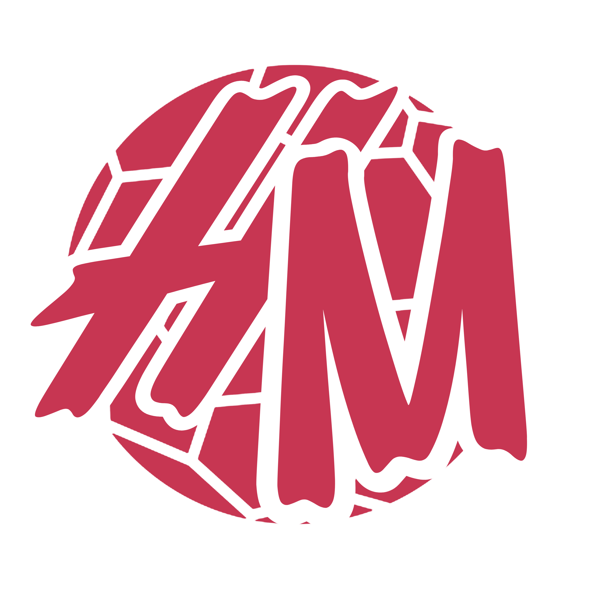

A women's handball management simulation for Android, live on Google Play. Twenty-three
countries' leagues and three European competitions run inside one world model — every club in
every country plays its own season, whether or not the player ever looks at it — and the
player's own matches are played live by an agent-based 2D match engine.

Built solo, end to end: the world simulation, the 2D match engine, persistence, the front ends,
the test suite, the data collection, and the store release.

[**Google Play**](https://play.google.com/store/apps/details?id=com.handballmanager.mobile) ·
[Releases (APK / Windows)](../../releases) ·
[Engineering notes](#engineering-notes) ·
[The 2D engine's source](engine2d/) ·
[Code samples](samples/)

> The game is closed source ahead of a commercial release. This repository holds the builds,
> the write-ups, the full source of the 2D match engine to read in [`engine2d/`](engine2d/), and
> two MIT-licensed extracts in [`samples/`](samples/). **The complete source is available to
> reviewers on request** — get in touch through the email on the Google Play listing.

  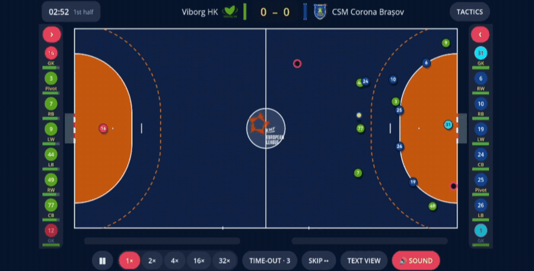
   
  A European League night on the 2D court, at normal speed: every player is an agent deciding ten times a second.

<table>
<tr>
<td align="center" width="33%">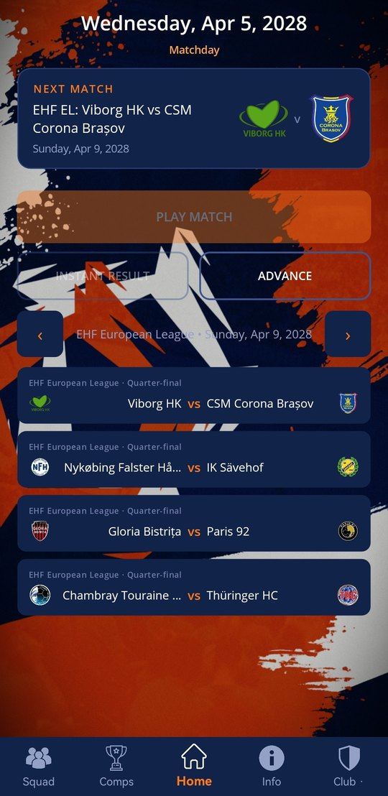 A European week: the whole app in the competition's colours</td>
<td align="center" width="33%">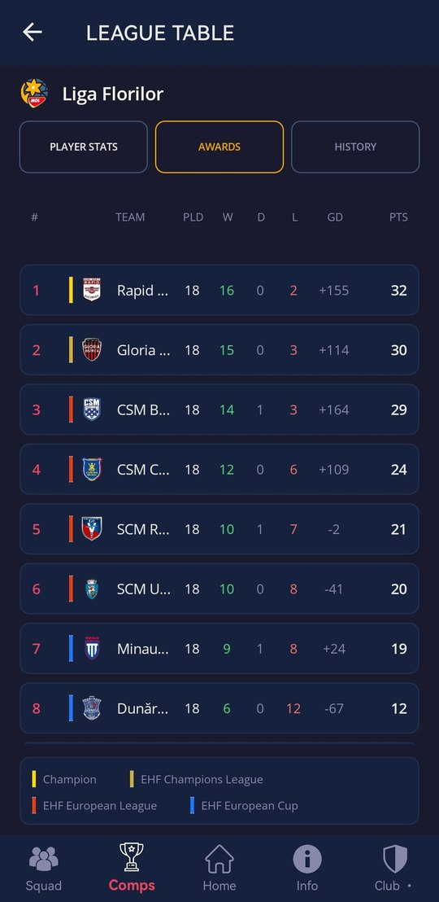 League table with title, European and relegation places</td>
<td align="center" width="33%">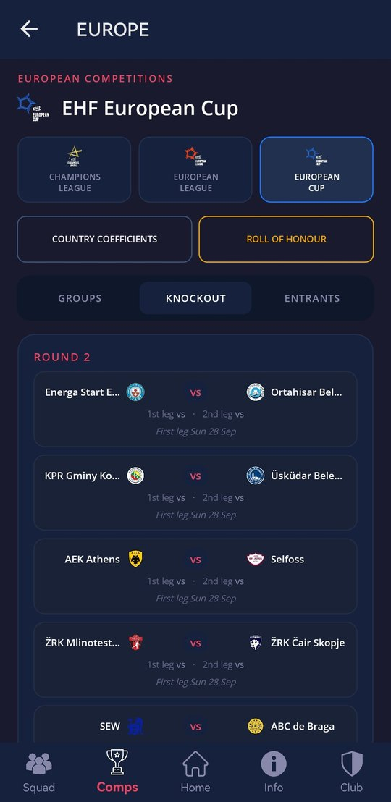 The EHF European Cup, two-legged from Round 2</td>
</tr>
<tr>
<td align="center" width="33%">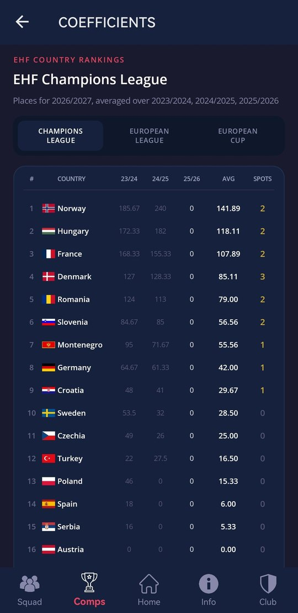 EHF coefficient rankings deciding each country's places</td>
<td align="center" width="33%">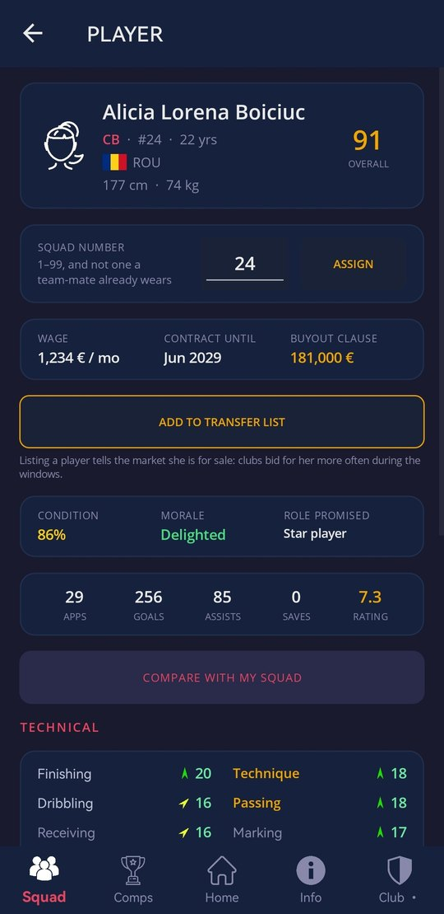 Player profile: attributes, contract, buyout clause, transfer list</td>
<td align="center" width="33%">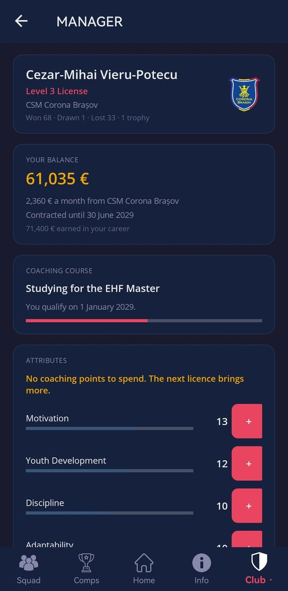 The manager career: licences, a wage and your own balance</td>
</tr>
<tr>
<td align="center" width="33%">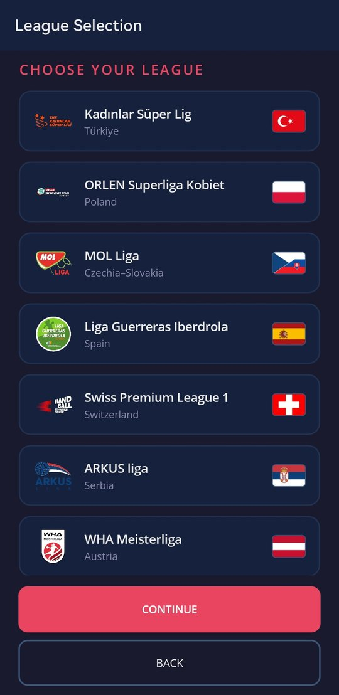 23 countries' leagues to start a career in</td>
<td align="center" width="33%">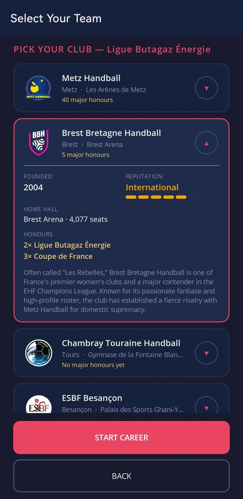 Every club with its hall, standing and honours</td>
<td align="center" width="33%">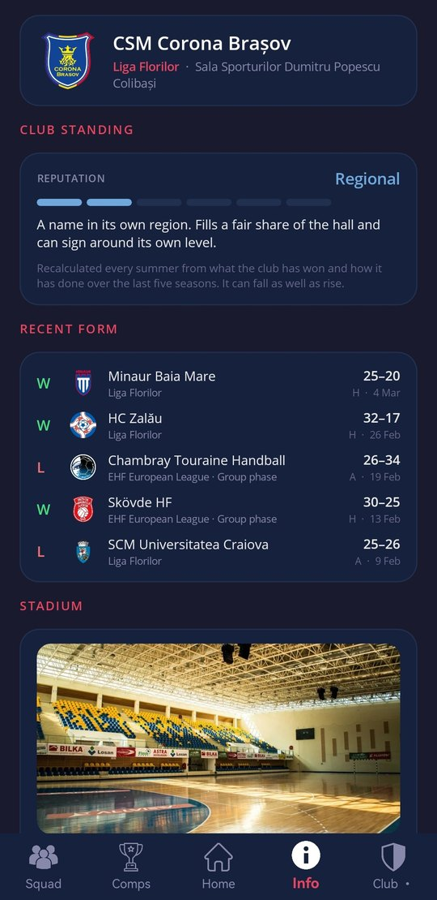 Club page: reputation, form and home arena</td>
</tr>
</table>

---

## Stack

| | |
|---|---|
| Language / runtime | C# 13, .NET 10 |
| Mobile | .NET MAUI (Android, API 24+) |
| Desktop | WPF (Windows) — no longer updated; the model layer is shared |
| Persistence | EF Core 9 over SQLite, `SQLitePCLRaw` bundled for Android |
| UI pattern | MVVM, `CommunityToolkit.Mvvm` source generators |
| Localisation | Six languages; English text is the key into embedded JSON tables, held complete by a test |
| Tests | xUnit |

## Shape of the codebase

| Project | Lines | Files | What it is |
|---|---:|---:|---|
| `HandballManager.Core` | 67,100 | 206 | Simulation, the 2D match engine, persistence, and **every view model**. References no UI framework. |
| `HandballManager` | 14,300 | 91 | WPF desktop head — views only, no longer updated |
| `HandballManager.Mobile` | 17,900 | 154 | .NET MAUI head — views, the 2D court renderer, session plumbing, Android packaging |
| `HandballManager.Tests` | 17,800 | 71 | xUnit; about 1,500 test cases, many of them full-season integration runs |

51 services and 30 tables in Core. Putting the view models there rather than in either
front end is the decision the whole project rests on: both heads bind to the same
`HomeViewModel`, so a feature is wired once instead of twice, and the desktop app became a mobile
port without the model layer being touched. The trade-offs are in
[Architecture](docs/architecture.md).

## The simulation

The world advances one day at a time. On any date the engine plays every fixture in every
competition, ages and trains ~4,800 players, runs the AI transfer market, pays wages, sells
tickets, and writes the news and statistics behind all of it.

Three problems that took the most work:

- **Competition shape is data, not code paths.** Twenty-three countries do not play the same game
  administratively. Montenegro's eight clubs meet three times. Slovenia's thirteen meet once —
  one club idle every round — then split into two groups carrying points down by finishing
  position. Türkiye splits and carries each club's points in full, so a group table where a club
  that won nine of twelve finishes second is correct. Poland pays three points a win and settles
  every drawn match with a shoot-out that leaves the scoreline a draw; Portugal pays a point for a
  defeat, and splits its table carrying half of everyone's points, rounded up.
- **The default failure mode is silence.** An eleven-club league generates no fixtures rather
  than throwing. A competition with no prize-money tier pays nothing to anyone, forever. A country
  with no youth name pool quietly produces Romanian teenagers. Most of the work on each new
  country goes into turning that class of bug into a test that fails loudly instead.
- **European qualification has to stay exact.** Three competitions, each with its own
  three-season coefficient ranking, however those rankings move and however many countries exist.
  The Champions League is sixteen: nine guaranteed places, an incentive place for the European
  League's leading country, and upgrades walked back down the ranking. The European League takes
  banded places (four, three, two or one by rank) into a field of 28 to 52, and the field size
  alone decides who plays Round 2, who enters at Round 3 and who goes straight to the groups. The
  EHF European Cup gives each country what is left of four places after the other two, tops up to
  thirty-two down its own ranking, and fills a short round with lucky losers. Written as rules
  rather than lookup tables, which is why the totals hold when a country is added. The original
  two-competition allocator is in [`samples/`](samples/EuropeanPlaceAllocator.cs) with its tests.
- **A save is more than what is stored in it.** Careers run for dozens of hours and have no backup,
  so every release has to open every older save untouched. New columns are the obvious risk; the
  subtle one is what is *rebuilt* on load. League rounds carry no date — the calendar is recomputed
  each session and moves rounds off European weekends onto Wednesdays the cup has not claimed — so
  when 3.5 replaced six countries' group-stage cups with their real knockout formats, changing the
  cup's dates would have silently moved unplayed league rounds in seasons already underway. Old
  draws finish on the old path and the old calendar, held there by a test against a snapshot of the
  previous release's output, taken before the change was written. 4.0 did the same again for
  Europe: 253 calendars snapshotted before the European League's qualifying rounds and the European
  Cup moved any date.

## The 2D match engine

  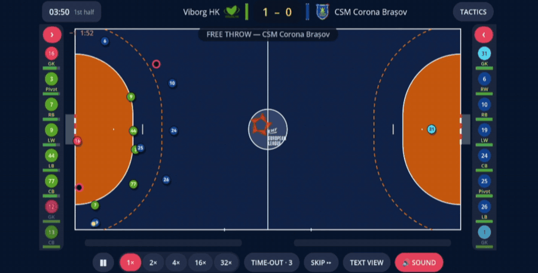
   
  A seven-metre stops the match to ask who takes it, ranked by the attribute that decides it.

<table>
<tr>
<td align="center" width="50%">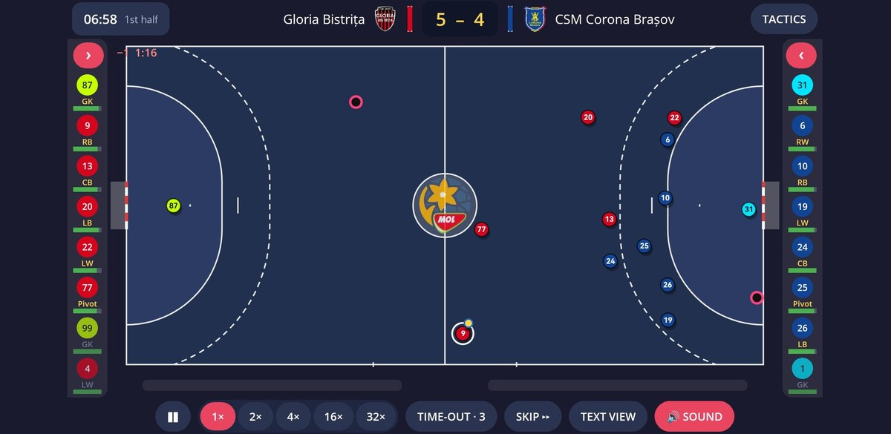 Panels folded: the court takes the screen</td>
<td align="center" width="50%">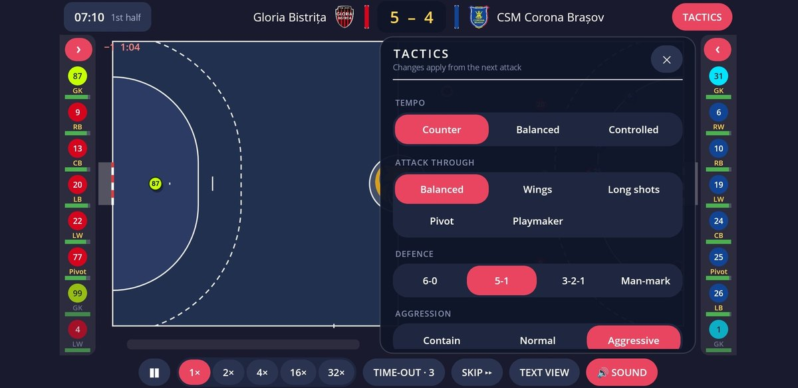 Tactics from the bench, applied from the next attack</td>
</tr>
</table>

Since 4.0 the player's own matches are played on a 2D court by an agent-based physics engine. Every
player is an agent that perceives, decides and moves ten times a second: movement from pace,
acceleration, agility and stamina; shots as geometry, with the release point, the aim error from
finishing and composure under pressure, blocks by arms actually in the path, and a keeper's reach
against the ball's flight time; passes that can be intercepted or fumbled; and referees applying
the rules to what happens rather than rolling for it. The carrier prices shooting, passing,
driving and holding in goals; defences play 6-0, 5-1, 3-2-1 or man-marking. The other bench is
an AI coach that reads the score and the clock.

The hard part was not making it move but making it agree with the rest of the game. Every other
match in the world is still simulated by the statistical engine — a season is thousands of them —
so a watched match and a simulated one have to produce the same handball. The physics engine was
calibrated over hundreds of matches to the statistical one, then both were re-anchored to real
women's handball: about 57 goals a match, nine-metre shots going in about two times in five,
keepers saving a third of what reaches them, and the same home-points share at every gap in squad
strength. It only matched that curve once each match had its own day form; without it, the
stronger side won too reliably. The anchors are pinned by a test that fails when a tuning change
drifts them.

The engine's full source — about 9,600 lines, the simulation, the court renderer and its tests —
is in [`engine2d/`](engine2d/), with a reading guide.

## Performance

Simulating a day is the hot path, and it degraded over a career rather than being slow up front —
the more interesting kind of problem. `SimulationProfiler` (in the test project, inert unless
`HM_PROFILE=1`) times each phase of a day against a database with real mileage on it.

| | before | after |
|---|---:|---:|
| 400 simulated days | 449.8 s | 166.1 s |
| avg day, first 20 | 947 ms | 322 ms |
| avg day, last 20 | 1,276 ms | 355 ms |
| EF-tracked entities by June | 161,372 | 11,805 |

The causes were an EF change tracker that never released finished match rows, so every save
walked a graph that grew all season, and player training running daily across every player in the
world instead of weekly. Later passes found `DetectChanges` costing 23.7 ms per call — against
1.37 ms for a squad load — and four callers saving unconditionally on days with nothing to save.

Two plausible hypotheses measured *negative* and were dropped: indexing the match table (noise),
and storing less match detail for other countries' games (~7%, inside run-to-run variance — the
cost is deciding what happened, not writing it down). Full write-up:
[Making a career fast](docs/performance.md).

## Testing

About 1,500 xUnit test cases, deliberately weighted towards integration:

- **Season-completion tests** hand the player a random club, play a whole season through the real
  view-model commands, then assert that *nothing anywhere in the world* is left unplayed. It
  exists because the world-simulation loop once looked only for the player's own supercup,
  leaving two other countries' finals unplayed all season with no error anywhere.
- **Seed-data tests** enumerate the embedded club data and check squad shape, position-correct
  attribute blocks, present crests and arena photos, prize tiers for every competition, real head
  coaches, and that nothing seeded narrates a season the player is about to play.
- **Fixture-clash tests** prove, without simulating anything, that no competition can schedule a
  knockout tie onto a date its own league already uses.
- **Balance-report tests** produce the cross-league comparison described below.
- **Compatibility tests** open a deliberately old-schema save through the paths that read it before
  upgrading it, and hold a season still playing an old cup format, or the old European formats, to
  the calendar the previous release produced, day for day.
- **Engine tests** play the 2D engine headless: determinism for a seed, knockouts that always
  produce a winner, the calibration anchors, and the match screen's view model at 32× — the court
  never shows a result before it happens.

The regression tests added for the bugs players reported against 3.4 were each run with their fix
switched off first, to see them fail, before being kept.

The full suite plays roughly twenty seasons of a multi-country world and runs over an hour,
which is its own design constraint — the seed-data subset runs in about 20 seconds for the
iteration loop.

## Data

253 clubs and 4,826 players with real squads, birthdates, positions, shirt numbers, heights and
head coaches, assembled from twenty-three countries' federations plus the EHF. Very little of it was
offered as a download; most came out of undocumented JSON behind Angular and Vue front ends,
JavaScript object literals that are not quite JSON, and base64 PDF match reports.

Fetching it is the easy half. Federation sites drift to the current season while the game is
pinned to 2025/26; one public table was two seasons stale with nothing on the page saying so;
one federation registers a goalkeeper born in 2015 with eleven appearances; one reigning champion
enters its league with an under-18 side and fields its internationals only in the final. Where
positions are unpublished, shot-zone distributions classify them at 100% — but only where zone
data exists, since on goals and shots alone the best classifier managed 45% against a 35%
baseline. Full write-up: [Building a world from federation data](docs/data-pipeline.md).

## Balance

Twelve leagues rated country by country over several months have no agreed scale between them,
and a domestic table cannot measure one league against another. Cross-border European matches are
the only instrument, so the European competitions doubled as the tooling for the balance problem:
five seasons with transfers off, cross-border results only, targets set on the raw attribute
scale. The countries added since were pitched the same way before they shipped:
squad strength set between two existing leagues, then checked on simulated seasons of
cross-border results.

The most useful result was negative — between two runs *with no rating change at all*, one league
went from three different champions to the same club winning five from five. Five seasons cannot
resolve a title race, and a clean sweep is not evidence of a broken league.
[Levelling twelve leagues](docs/balance-calibration.md).

## Engineering notes

- [**One core, three heads**](docs/architecture.md) — the project split, why the view models live
  in Core, `EnsureCreated` versus migrations and what that costs forever, and the re-entrancy rule
  a shared `DbContext` imposes.
- [**Making a career fast**](docs/performance.md) — profiling a simulated day, the fixes worth
  2.7x, and two well-reasoned hypotheses that measured as noise.
- [**Building a world from federation data**](docs/data-pipeline.md) — sourcing the first 2,698 players,
  the four ways the data lies, and the validation suite that rejects it.
- [**Levelling twelve leagues**](docs/balance-calibration.md) — measuring leagues against each
  other, and how many seasons it takes before a result means anything.

## Code samples

The 2D match engine is published in full, to read, in [`engine2d/`](engine2d/).

Two pieces of the simulation, extracted with their tests and MIT licensed — [`samples/`](samples/):

- [`RoundRobinScheduler`](samples/RoundRobinScheduler.cs) — a season's fixture list for any number
  of clubs and any number of meetings, with byes where the division is odd
- [`EuropeanPlaceAllocator`](samples/EuropeanPlaceAllocator.cs) — splitting 16 and 32 European
  entries between countries by coefficient ranking (the two-competition version, before 4.0)

## The game itself

Twenty-three countries, 60 competitions

| | Country | Competitions |
|---|---|---|
| 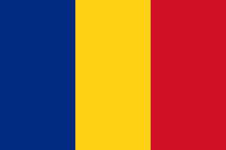 | Romania | Liga Florilor · Cupa României · Supercupa României |
|  | Hungary | NB I · Magyar Kupa |
|  | France | Ligue Butagaz Energie · Coupe de France |
| 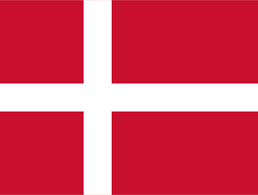 | Denmark | Kvindeligaen · Landspokalturnering · SuperCup |
| 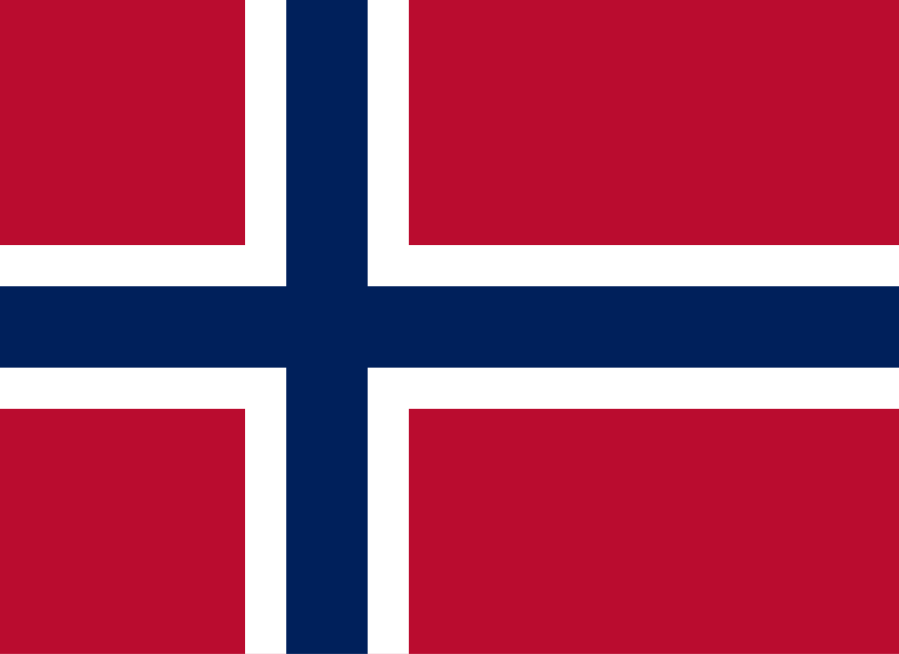 | Norway | REMA 1000-ligaen · Norgesmesterskapet |
| 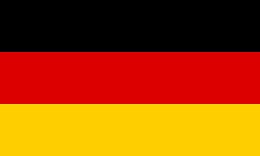 | Germany | 1. Bundesliga Frauen · DHB-Pokal · DHB Supercup |
| 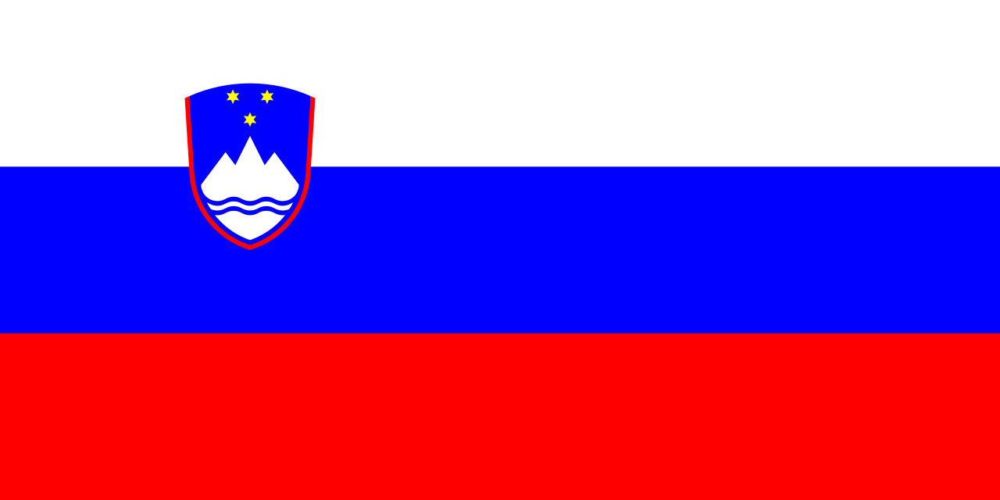 | Slovenia | 1. SRL ženske · Pokal Slovenije |
| 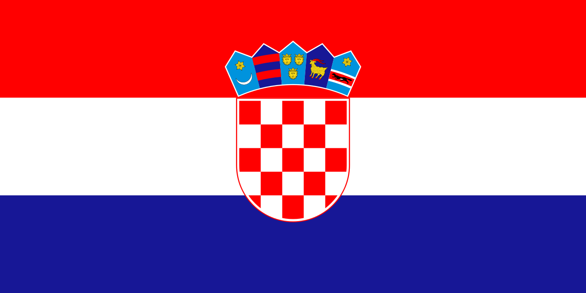 | Croatia | 1. HRL Žene · Hrvatski kup |
| 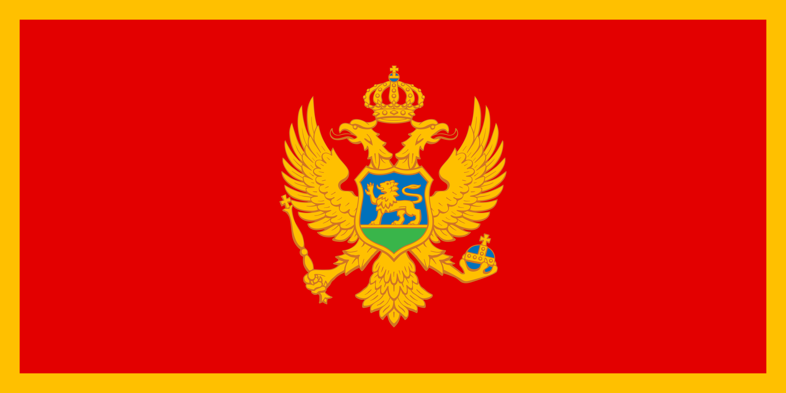 | Montenegro | Prva liga · Kup Crne Gore |
| 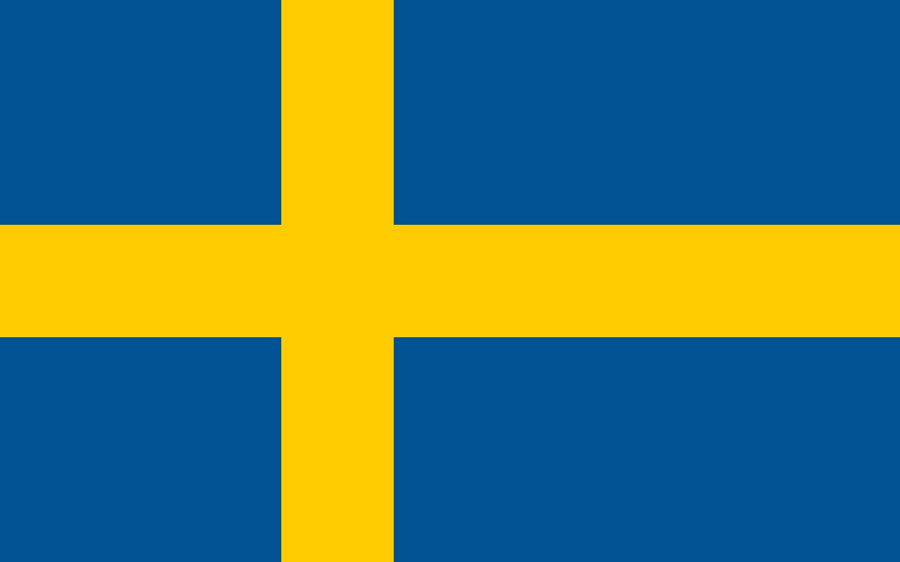 | Sweden | Handbollsligan · Svenska Cupen |
| 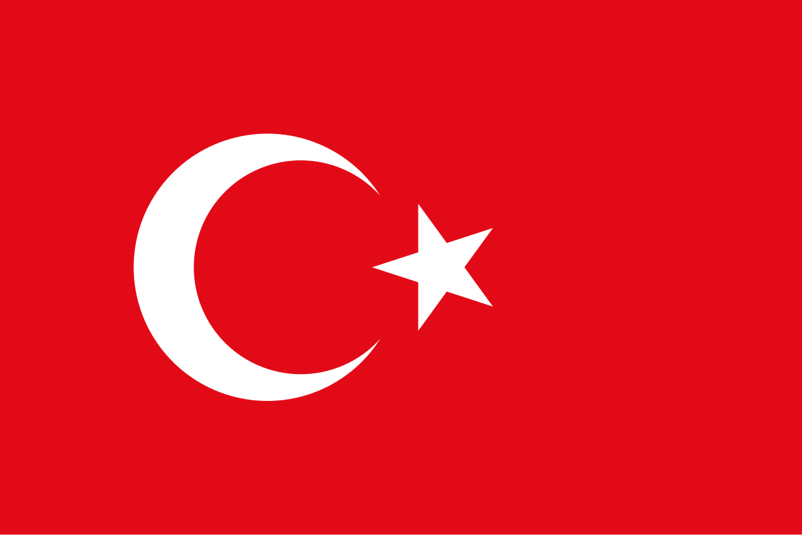 | Türkiye | Kadınlar Süper Lig · Kadınlar Kupası · Süper Kupa |
| 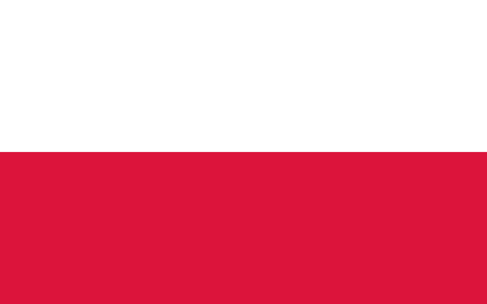 | Poland | ORLEN Superliga Kobiet · Puchar Polski · Superpuchar |
|  | Czechia | MOL Liga, then a Czech title play-off · Český pohár žen |
|  | Slovakia | MOL Liga, then a Slovak title play-off · Slovenský pohár žien |
|  | Spain | Liga Guerreras Iberdrola · Copa de la Reina · Supercopa de España (from 2026/27) |
|  | Switzerland | Swiss Premium League 1 · Mobiliar Handball Cup |
| 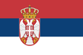 | Serbia | ARKUS liga · Kup Srbije · Superkup Srbije |
|  | Austria | WHA Meisterliga · ÖHB Cup · WHA Supercup |
|  | North Macedonia | Super Ženska Liga · Kup na Makedonija |
|  | Portugal | 1ª Divisão Feminina · Taça de Portugal · Supertaça Feminina |
| 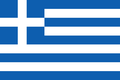 | Greece | A1 Women · Greek Cup · Greek Super Cup |
| 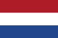 | Netherlands | Super Handball League Women · Landelijke Beker · Handbal SuperCup |
|  | Iceland | Olís deild kvenna · Powerade bikarinn · Meistarakeppni HSÍ |
| 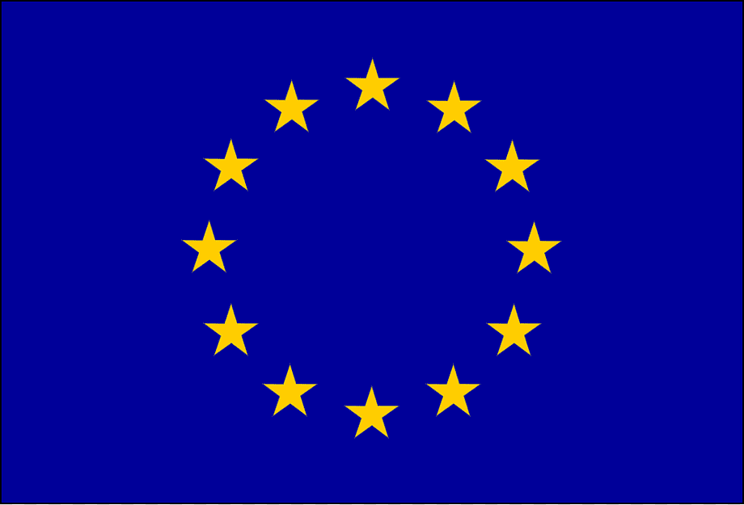 | Europe | EHF Champions League · EHF European League · EHF European Cup |

Squad selection and live matches on the 2D court, contract and transfer negotiation, a transfer
list, scouting, youth intake and development, club facilities, finances down to gate receipts,
dynamic attendance, and a full honours history for every club.

Since 3.1 the manager is a career in their own right: coaching licences studied for out of your own
balance, a contract and a wage, a board that sets objectives and grades you monthly against what a
club of that size should be doing, and the sack if the grade stays bad. A job market runs across
every country whether or not you are in it, so being out of work is a state the game
supports rather than an ending. European ties bring the competition's own colours and backgrounds
to the whole app for as long as the next fixture is a European one, with an intro film once a
season.

3.3 took the match itself deeper: injuries, fitness that carries from one match to the next and the
squad rotation that follows from it, two-minute suspensions and seven-metre throws, a training
calendar, tactics changed from the bench during a match, and a dressing room that remembers the
playing time it was promised. Since 3.5 the six cups that had stood in with group stages play their
real formats — straight knockouts with seeded byes, and France's pool phase for the clubs not in
Europe. 3.6 added Czechia and Slovakia's joint MOL Liga, Spain and Switzerland.

4.0 is the largest release since launch. Seven more countries — Serbia, Austria, North Macedonia,
Portugal, Greece, the Netherlands and Iceland — take the world to twenty-three, enough for the
EHF European Cup to arrive as the third European competition and for the European League to play
its real qualifying rounds. The player's matches moved to the 2D engine described above, with the
whole bench to manage while they run.

4.1 put the game into six languages — English, French, German, Spanish, Romanian and Danish — with
the English text itself as the key, so a string is translated where it is written and a test
fails the build if any table is missing one or drops a placeholder. Club and competition names are
never translated. The same release rebuilt the screens a manager sees most: a home screen built
around the date and the next match, a season calendar, a tabbed match report with a graph of the
score, and squad and contracts screens that no longer cut names short.

4.5 puts every live match under its competition's own TV-style scoreboard, with half-time and
full-time screens, and reworks the keepers: they dive for the ball, hold long shots to about two
in five, and read seven-metres. Between the two, the game gained sponsors, league-level wages, a
Finances screen with a season chart, a manager screen with a trophy cabinet, and 50 achievements.
Version history is in [CHANGELOG.md](CHANGELOG.md).

## License & copyright

**© 2026 Vieru-Potecu Cezar-Mihai. All rights reserved.** No redistribution, no commercial use;
all rights to the match engine, simulation logic and branding are reserved. The `engine2d/`
directory is published to read, not to reuse — see [engine2d/LICENSE](engine2d/LICENSE). The
`samples/` directory is MIT licensed — see [samples/LICENSE](samples/LICENSE).

## Disclaimer

Handball Manager is a fan-made project and is not affiliated with, endorsed by or connected to
the EHF, any national handball federation or league, or any club or player represented in it.
